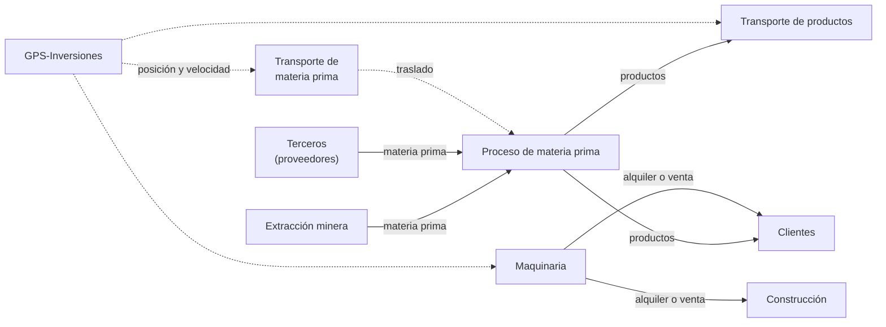
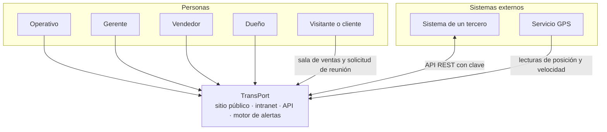
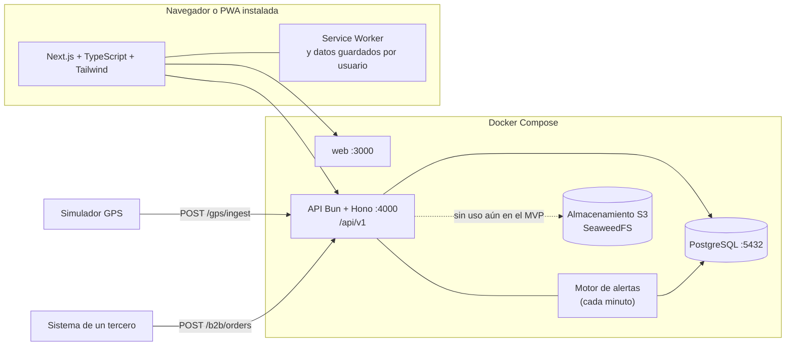
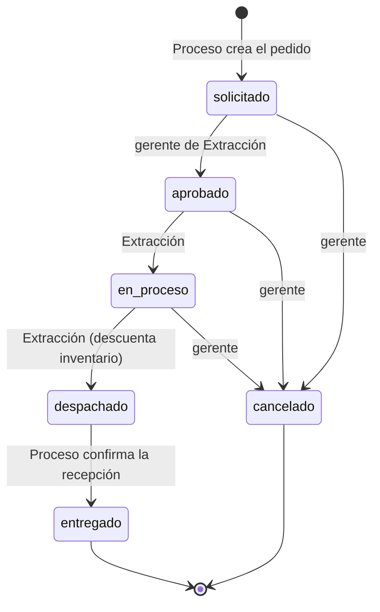
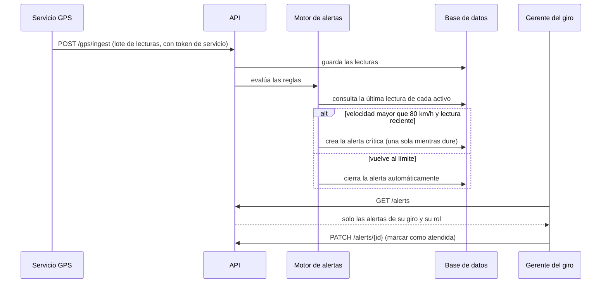
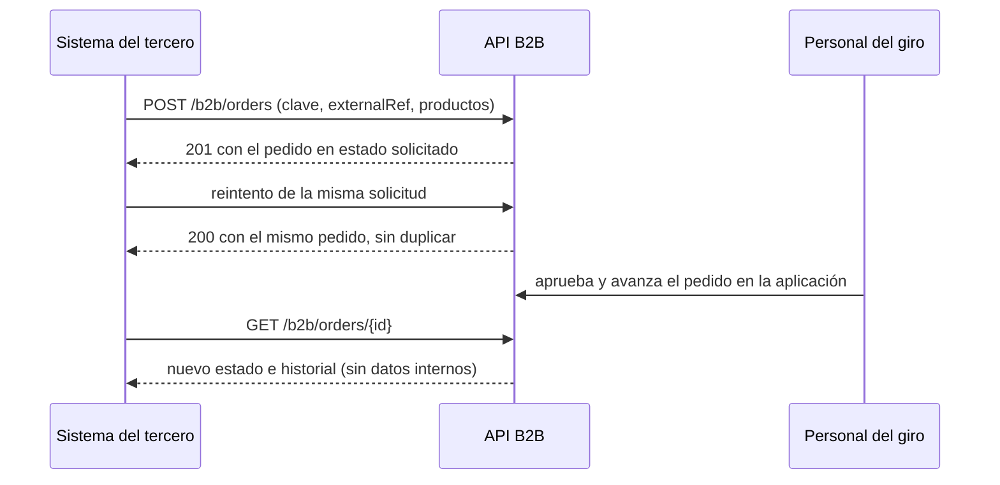
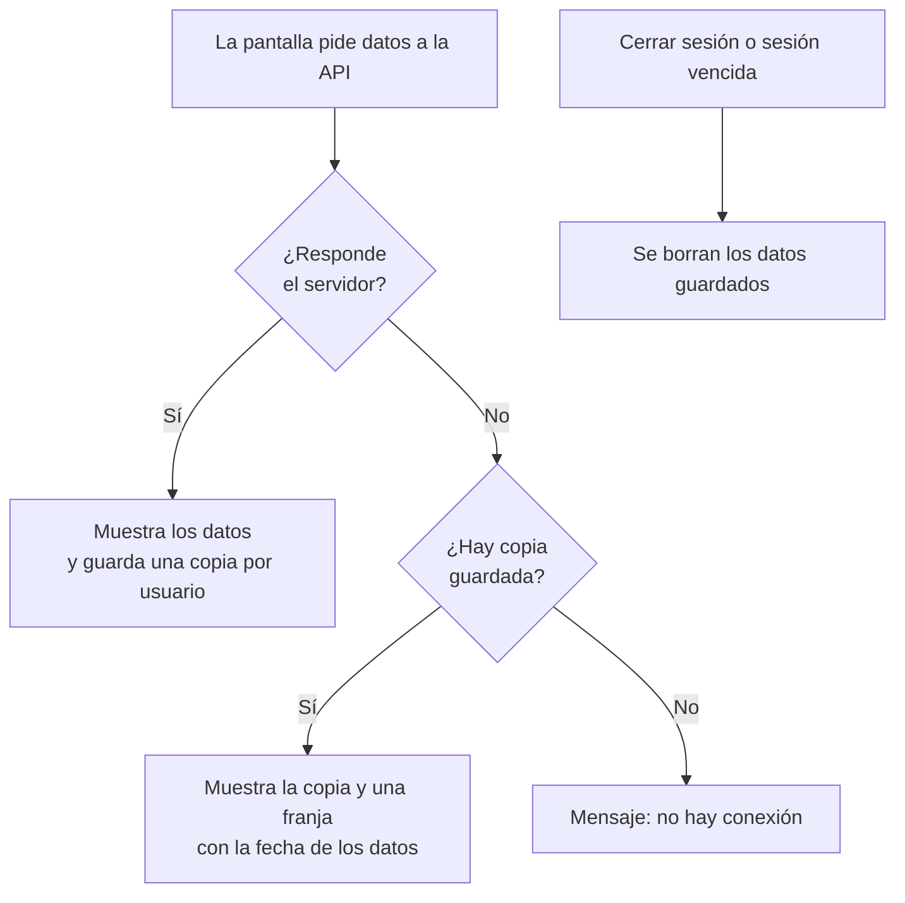
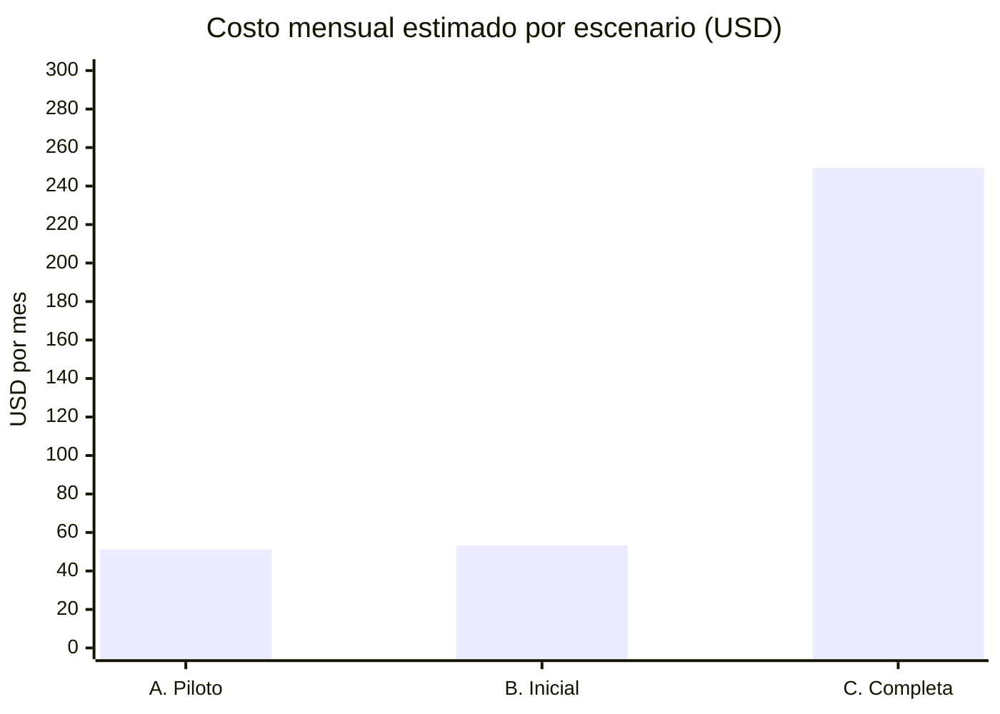

# 00 - TransPort: resumen para la presentación

| | |
|---|---|
| **Proyecto** | TransPort. Proyecto final de Desarrollo Web, Universidad Mariano Gálvez, 2026 |
| **Documento** | Visión general del problema, la solución, el sistema construido y una guía para la demostración |
| **Estado** | Versión 1.0 |
| **Documentos relacionados** | [README](../README.md), [03-alcance](03-alcance.md), [04-arquitectura](04-arquitectura.md), [09-costos-nube](09-costos-nube.md) |

## 1. En una frase

TransPort es una plataforma web, instalable como aplicación, que reemplaza los procesos manuales de un grupo empresarial guatemalteco de **seis giros de negocio**: ordena los pedidos entre giros, da a la dirección una vista consolidada, abre un canal con clientes y terceros, y genera las **alertas** que el sistema de GPS actual no produce.

## 2. El problema

TransPort es una empresa ficticia basada en modelos reales de Guatemala. Cada giro lleva su propio presupuesto y control, pero hoy todo se hace a mano.

| Hoy | Consecuencia | Qué hace el sistema |
|---|---|---|
| Los giros se piden material por teléfono o correo | Retrasos en producción y nadie sabe qué está pendiente | Pedidos entre giros con estados, responsables, historial y mensajes |
| Nadie ve el conjunto | La dirección se entera tarde de los problemas | Panel por giro y resumen consolidado del dueño |
| El GPS solo se ve en un navegador y no avisa | Excesos de velocidad y paradas pasan inadvertidos | Alertas propias sobre las lecturas GPS, dirigidas por rol |
| Un cliente cementero hace sus pedidos por correo | Reprocesos y errores de transcripción | API para terceros, con pedidos idempotentes |
| El operativo trabaja en campo, con señal irregular | La aplicación de escritorio no le sirve | PWA instalable que se consulta sin conexión |

## 3. La solución

Cada persona entra por la misma aplicación, pero ve solo lo que le corresponde por su **membresía** (un rol en un giro, o en toda la organización).

| Rol | Qué ve y hace |
|---|---|
| Dueño | Resumen de los seis giros, alertas y flota de toda la organización |
| Gerente de giro | Panel del giro, aprueba pedidos, recibe alertas y gestiona reuniones |
| Operativo | Pedidos del giro, avanza estados, ajusta inventario (por API) y ve alertas y flota |
| Vendedor | Pedidos y reuniones que se le asignan |
| Administrativo | Consulta los pedidos de su giro; el presupuesto y los gastos quedan diseñados |
| Cliente | Aún sin cuenta: pide reuniones desde la sala de ventas; el portal de cliente queda diseñado |
| Cliente de API (tercero) | Crea y consulta sus propios pedidos con su clave |

## 4. Qué se construyó

El proyecto es individual y dispone de menos de un mes, así que se **diseñó** todo y se **implementó** un corte vertical que funciona de extremo a extremo.

| Capacidad | Estado | Dónde verlo |
|---|---|---|
| Inicio de sesión con permisos por rol y giro | Implementada | `/login` |
| Pedido interno entre giros (crear, aprobar, despachar con descuento de inventario, confirmar recepción, mensajes) | Implementada | `/pedidos` |
| Panel por giro | Implementada | `/panel` |
| Resumen consolidado del dueño | Implementada | `/resumen` |
| Alertas: pedido retrasado, stock bajo, exceso de velocidad | Implementada | `/alertas` |
| Flota y GPS: estado, mapa esquemático, velocidad frente al límite | Implementada | `/flota` |
| Sala de ventas pública y solicitud de reunión con asignación de vendedor | Implementada | `/`, `/contacto`, `/reuniones` |
| API para terceros con clave, alcances e idempotencia | Implementada | `/api/v1/b2b` |
| PWA: instalable y con consulta sin conexión | Implementada | botón "Instalar aplicación" |
| Presupuesto y gastos, webhooks, EDI/CSV, notificaciones push, GPS real | Solo diseñadas | [03-alcance](03-alcance.md) |

En números: **9 documentos de diseño**, más de **50 endpoints**, **13 pantallas** (9 de la aplicación y 4 del sitio público, más la página sin conexión), **39 pruebas unitarias**, **318 verificaciones de extremo a extremo** contra la API en ejecución y una verificación de la PWA en Chrome real.

## 5. Arquitectura

| Decisión | Elección | Por qué (ver ADR en [04-arquitectura](04-arquitectura.md)) |
|---|---|---|
| Frontend | Next.js, TypeScript y Tailwind, una sola aplicación con zonas por rol | Sitio público con renderizado en servidor y portales en el mismo código |
| API | Bun, Hono, Drizzle y Zod, versionada en `/api/v1` | Rápida, con TypeScript de punta a punta y validación en cada entrada |
| Base de datos | PostgreSQL | Los datos son relacionales: giros, pedidos, inventario |
| Autenticación | JWT que solo identifica al usuario; los roles se leen de la base en cada solicitud | Un cambio de membresía surte efecto de inmediato |
| Terceros | Claves por cliente, guardadas como hash, con alcances y giros permitidos | Una filtración de la base no expone claves utilizables |
| Despliegue | Contenedores; nube solo como propuesta (Google Cloud con Cloudflare) | Todo se demuestra en local sin depender de internet |

Cuatro ideas de diseño que conviene destacar:

1. **Un solo modelo de pedido** para tres orígenes: interno, de cliente y de tercero. Cambian el origen y el destino, no la estructura.
2. **Permisos por membresía**, no por usuario: una persona puede ser gerente en un giro y vendedora en otro.
3. **Las alertas son condiciones, no eventos.** Una condición abre una sola alerta mientras dure, se actualiza sola y se cierra cuando desaparece; si alguien la atiende y la condición sigue, no vuelve a abrirse.
4. **Los pedidos de terceros son idempotentes.** Reintentar la misma solicitud devuelve el mismo pedido, incluso con solicitudes simultáneas.

## 6. Flujos clave

### 6.1 El pedido entre giros

El flujo implementado de punta a punta: la planta de proceso pide materia prima a la extracción.

Cada paso exige el rol correcto en el giro correcto. Un paso que no está en el diagrama responde `409`; un paso válido sin permiso, `403`. Si el inventario del proveedor no alcanza, el despacho se rechaza (`422`) y el pedido conserva su estado.

### 6.2 De una lectura GPS a una alerta

El motor corre además cada minuto, para detectar condiciones que no dependen de una lectura nueva: un pedido que se vence o una existencia que baja del mínimo.

### 6.3 Un tercero crea un pedido

### 6.4 Sin conexión

Sin conexión se consulta lo ya visitado; crear o cambiar pedidos exige red, porque encolar cambios exigiría resolver conflictos.

## 7. Guion de demostración (unos 12 minutos)

**Preparación.** Con Docker en marcha, `docker compose up -d --build` carga los datos de ejemplo. La contraseña de todos los usuarios es el valor de `SEED_PASSWORD` del `.env`. Para que haya alertas de velocidad, en `apps/api` se ejecuta `bun run gps:sim`. Si se corrió antes la prueba de extremo a extremo, conviene recrear la base (`docker compose down -v`) para recuperar las reuniones de ejemplo.

| Min | Qué mostrar | Usuario | Qué decir |
|---|---|---|---|
| 0:00 | Landing pública, carrusel de giros y catálogo | Sin sesión | La cara pública: los seis giros y el catálogo vienen de la API |
| 1:30 | Formulario de reunión en `/contacto#reunion` | Sin sesión | Un cliente pide una reunión y se asigna al vendedor del giro con menos carga |
| 2:30 | `/reuniones` | `vendedor@transport.gt` | El vendedor ve la solicitud y la confirma con fecha |
| 3:30 | Crear un pedido de Extracción | `operativo@transport.gt` | La planta de proceso pide material; muestra la existencia del proveedor |
| 4:30 | Aprobar el pedido | `gerente@transport.gt` | Solo el gerente del proveedor aprueba; el historial queda registrado |
| 5:30 | Pasar a en proceso y despachar | `operativo.extraccion@transport.gt` | Despachar descuenta el inventario; si no alcanza, lo rechaza |
| 6:30 | Confirmar la recepción | `operativo@transport.gt` | Cierra el ciclo del lado del solicitante |
| 7:00 | `/alertas` y `/flota` | `gerente.transporte@transport.gt` | Un camión pasó de 80 km/h: alerta crítica y gráfica contra el límite |
| 8:30 | `/resumen` y el panel de un giro | `dueno@transport.gt` | Los seis giros en una vista, con su situación; cada fila abre el panel |
| 9:30 | Una llamada `curl` a la API B2B, repetida | Clave del cliente de ejemplo | Primera vez `201`, segunda `200` con el mismo pedido |
| 10:30 | Instalar la aplicación y simular "Sin conexión" en DevTools | Cualquiera | Se abre lo ya visitado, con aviso de la fecha de los datos |
| 11:30 | Cierre | | Qué sigue y las limitaciones (sección 9) |

Los usuarios de ejemplo y los permisos de cada uno están en el [README](../README.md). El comando de la API B2B y el de la instalación como PWA también.

## 8. Calidad y seguridad

| Aspecto | Qué se hizo |
|---|---|
| Pruebas | 39 pruebas unitarias de las reglas de negocio (estados del pedido, alertas, reuniones, claves, flota) y 318 verificaciones de extremo a extremo contra la API: permisos por rol, validaciones, idempotencia y concurrencia |
| Navegador real | La PWA se verificó en Chrome: manifiesto válido, instalable, funcionamiento sin conexión y borrado de datos al cerrar sesión. La prueba detectó un error real (el manifiesto no era reconocido) que se corrigió |
| Errores | Formato uniforme con código estable e identificador de solicitud; nunca se devuelven mensajes de la base de datos |
| Privacidad | Quien no tiene permiso sobre un recurso recibe `404`, no `403`: no se revela que existe |
| Secretos | En `.env`, fuera de git; las claves de API se guardan solo como hash |
| Formularios públicos | Campo trampa y límite de solicitudes por IP |

## 9. Limitaciones y qué sigue

Para presentar con honestidad, lo que **no** está hecho:

- Los datos son de ejemplo; no hay operación real ni se probó con usuarios.
- El mapa de la flota es **esquemático** (sin cartografía); un mapa real requiere una librería de mapas.
- No hay notificaciones push ni correo, webhooks, importación EDI/CSV ni presupuesto y gastos.
- Sin conexión no se pueden hacer cambios.
- No hay pantalla de inventario: el ajuste de existencias es solo por API.
- El token de sesión vive en `sessionStorage`; en producción convendría una cookie `HttpOnly`.
- La nube es una propuesta; la estimación de costos tiene supuestos hipotéticos y el precio de Cloud SQL debe validarse en la calculadora oficial.

Siguientes pasos naturales: pantalla de inventario, edición de reglas de alertas, webhooks firmados, mapa real y notificaciones push.

## 10. Nube y costos

La propuesta usa **Google Cloud** (Cloud Run, Cloud SQL, Pub/Sub) con **Cloudflare** al frente. Estimación mensual, en dólares, con supuestos explícitos:

Lo que más importa: **la base de datos administrada es entre el 86 % y casi el 100 % del costo**, y el costo sube por saltos de capacidad, no por usuarios. Detalle, fuentes y sensibilidad en [09-costos-nube](09-costos-nube.md).

## 11. Estructura sugerida para las diapositivas

| N.º | Diapositiva | Material |
|---|---|---|
| 1 | Título y la frase de la sección 1 | Sección 1 |
| 2 | El problema | Tabla de la sección 2 |
| 3 | Los seis giros y sus dependencias | Primer diagrama de la sección 2 |
| 4 | La solución y quién la usa | Diagrama y roles de la sección 3 |
| 5 | Qué se construyó y qué se diseñó | Tabla de la sección 4 |
| 6 | Arquitectura y decisiones | Sección 5 |
| 7 | El pedido entre giros | Sección 6.1 |
| 8 | Alertas con el GPS | Sección 6.2 |
| 9 | Integración con terceros y PWA | Secciones 6.3 y 6.4 |
| 10 | Demostración en vivo | Sección 7 |
| 11 | Calidad y seguridad | Sección 8 |
| 12 | Nube, costos, límites y siguientes pasos | Secciones 9 y 10 |

## 12. Mapa de la documentación

| Documento | Contenido |
|---|---|
| [01 - Requisitos](01-requisitos.md) | Requisitos funcionales y no funcionales |
| [02 - Dominio](02-dominio.md) | Giros, actores y problema |
| [03 - Alcance](03-alcance.md) | Qué se implementa y qué solo se diseña |
| [04 - Arquitectura](04-arquitectura.md) | Componentes y ocho decisiones de arquitectura |
| [05 - Datos y APIs](05-datos-y-apis.md) | Modelo de datos, endpoints y contratos |
| [06 - Infraestructura](06-infraestructura.md) | Entorno local y propuesta de nube |
| [07 - Interfaz](07-ui-wireframes.md) | Pantallas y wireframes |
| [08 - Plan y roles](08-plan-y-roles.md) | Plan de trabajo y riesgos |
| [09 - Costos de nube](09-costos-nube.md) | Estimación mensual con diagramas |

El desarrollo se apoyó en asistencia de IA, como permite el enunciado; el autor revisa y valida el código y la documentación.
