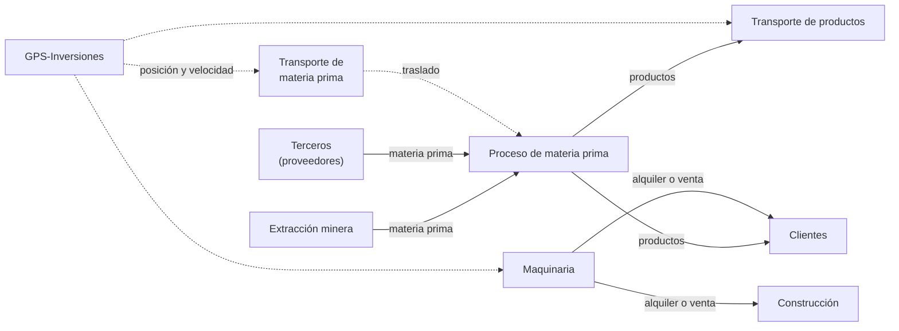

# 02 - Dominio del negocio

| | |
|---|---|
| **Proyecto** | TransPort |
| **Documento** | Descripción del negocio, actores, dependencias entre giros y problema a resolver |
| **Estado** | Versión 0.2 |
| **Documentos relacionados** | [01-requisitos](01-requisitos.md), [03-alcance](03-alcance.md), [05-datos-y-apis](05-datos-y-apis.md) |

## 1. Contexto

TransPort es una empresa ficticia, basada en modelos reales de Guatemala, con múltiples giros de negocio. Cada giro lleva su propio presupuesto y control de gastos, por lo que requiere una solución a medida. La empresa elabora hoy sus procesos de forma manual, lo que ha provocado problemas de control.

## 2. Giros de negocio

| N.º | Giro | Sedes | Observaciones |
|---|---|---|---|
| 1 | Extracción minera | Cobán, El Progreso, Quetzaltenango y Petén | Produce la materia prima. |
| 2 | Proceso de materia prima (pisos cerámicos y materiales de construcción) | Zacapa, Huehuetenango y Petén | Consume materia prima de la extracción y de terceros. |
| 3 | Venta y alquiler de maquinaria | Guatemala, Quetzaltenango, Zacapa y Petén | Inventario, contratos de alquiler y GPS por máquina. |
| 4 | Transporte de materia prima | Servicio a empresas como Cemex, Cementos Progreso e Hispacensa | Flota con GPS. |
| 5 | Transporte de productos | Entre puertos, entre fronteras, de puerto a bodega y de bodega a puerto | Empresas nacionales y extranjeras. Flota con GPS. |
| 6 | Servicios de construcción | Puentes, carreteras y edificios | Proyectos y presupuestos por obra. |

La **sede central** se ubica en oficinas alquiladas en el edificio Sixtino, Zona 10. Desde ella se coordina y se lleva el registro contable y administrativo de todas las operaciones, y sirve de lugar para reuniones y videoconferencias para cerrar tratos. Cada giro cuenta además con oficinas y personal administrativo propios en cada sede.

## 3. Actores

| Actor | Necesidad principal |
|---|---|
| Empleado operativo (planta, flota, maquinaria u obra) | Registrar operaciones y recibir alertas de su giro. |
| Administrativo o contable de sede | Gestionar el presupuesto y los gastos del giro. |
| Vendedor | Atender pedidos y reuniones asignadas, y dar seguimiento a clientes. |
| Gerente de giro | Consultar reportes y alertas del giro y aprobar pedidos internos. |
| Dueño o administrador general (sede central) | Consultar reportes consolidados de todos los giros. |
| Cliente externo | Ver sus operaciones, pedidos y reportes, y comunicarse con la empresa. |
| Sistema de un tercero (por ejemplo, Cemex) | Integrarse mediante API, webhooks o intercambio EDI/CSV. |
| GPS-Inversiones (sistema externo) | Proveer posición, tiempo de uso y velocidad de cada dispositivo. **No forma parte del desarrollo.** |

## 4. Dependencias entre giros

Un pedido interno típico es el de la planta de proceso que solicita una cantidad de toneladas a la extracción. El sistema debe alertar si las existencias caen por debajo de un umbral o si un pedido se retrasa.

## 5. Problema a resolver

1. Los procesos se realizan de forma manual, con pérdida de control.
2. La aplicación de GPS actual solo se visualiza en navegador y no genera alertas.
3. No existe visibilidad consolidada para la toma de decisiones de la dirección.
4. No existe un canal de seguimiento y comunicación con los clientes.
5. Las dependencias entre giros, como el abastecimiento de materia prima, no se coordinan de forma oportuna.
