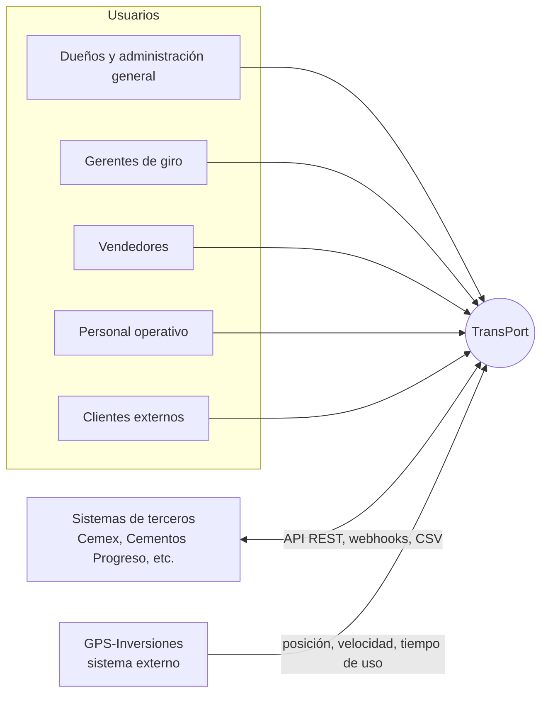
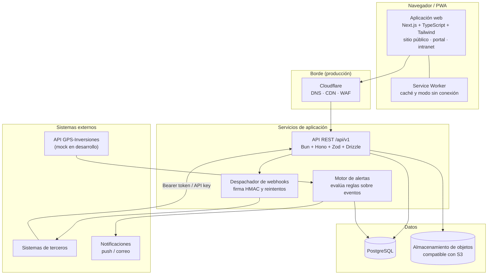

# 04 - Arquitectura de la solución

| | |
|---|---|
| **Proyecto** | TransPort: plataforma web integral para un grupo empresarial con seis giros de negocio |
| **Documento** | Arquitectura, componentes, dependencias y decisiones técnicas |
| **Autor** | Jaime (proyecto individual) |
| **Estado** | Borrador para revisión. Versión 0.1 |
| **Documentos relacionados** | [01-requisitos](01-requisitos.md), [02-dominio](02-dominio.md), [03-alcance](03-alcance.md), [05-datos-y-apis](05-datos-y-apis.md), [06-infraestructura](06-infraestructura.md) |

## 1. Propósito

Este documento describe la arquitectura propuesta para TransPort: los componentes del sistema, sus responsabilidades, cómo se comunican y por qué se eligió cada tecnología. Distingue lo que se **implementa** en el alcance del proyecto de lo que solo se **diseña** y propone para producción.

## 2. Resumen de la solución

TransPort es una plataforma de una sola base de código web con cuatro superficies:

1. **Sitio público ("sala de ventas")**: presenta los seis giros, su catálogo y permite solicitar pedidos o agendar reuniones con un vendedor.
2. **Portal de clientes**: seguimiento de pedidos, reportes de la relación con cada empresa del grupo y comunicación.
3. **Intranet**: operación de cada giro, pedidos entre giros, alertas y reportes consolidados para gerencia y dueños.
4. **API B2B**: interfaz versionada para que sistemas de terceros (por ejemplo, un cliente cementero) creen y consulten pedidos.

El sistema se instala como PWA para uso móvil y de escritorio, y se despliega con contenedores.

## 3. Drivers de arquitectura

Los requisitos que más condicionan el diseño (ver [01-requisitos](01-requisitos.md)):

| Driver | Origen | Implicación |
|---|---|---|
| Cada giro tiene presupuesto y control propios | Enunciado | Datos particionados por giro; permisos por giro. |
| Visión consolidada para la sede central | RF-02, RF-06 | Consultas agregadas entre giros con control de acceso. |
| Pedidos directos entre giros | RF-04 | Modelo de pedido único que cubre pedidos internos, de clientes y de terceros. |
| Alertas por rol e interés | RF-05, RF-10 | Motor de reglas desacoplado de la interfaz, alimentado por eventos. |
| Integración con terceros | RF-09 | API versionada, autenticación por cliente, webhooks firmados. |
| PWA multiplataforma | RNF-01 | Interfaz web instalable, con soporte sin conexión para consulta. |
| Despliegue reproducible | RNF-02 | Todo corre con `docker compose`. |
| Alcance acotado a un desarrollador | Contexto | Una base de código, pocas piezas operativas, decisiones simples. |

## 4. Vista de contexto

GPS-Inversiones es un sistema de terceros que **no se desarrolla**: TransPort consume sus datos y genera las alertas que su aplicación no ofrece.

## 5. Vista de componentes

### 5.1 Responsabilidades

| Componente | Responsabilidad | ¿Se implementa? |
|---|---|---|
| **Aplicación web** | Interfaz de las cuatro superficies. Renderizado en servidor para el sitio público (SEO). Rutas protegidas por rol para portal e intranet. | Sí |
| **Service Worker / PWA** | Instalación, caché de recursos, consulta sin conexión de datos recientes. | Sí (manifiesto y caché básica) |
| **API REST** | Autenticación, autorización por rol y giro, validación de entrada, lógica de negocio, versionado `/api/v1`. | Sí |
| **Motor de alertas** | Evalúa reglas (pedido retrasado, exceso de velocidad, stock bajo) y genera alertas dirigidas por rol. | Sí, al menos una regla |
| **Despachador de webhooks** | Notifica a terceros cambios de estado de pedidos con firma HMAC. | Solo diseñado (extra si sobra tiempo) |
| **PostgreSQL** | Fuente de verdad relacional. | Sí |
| **Almacenamiento de objetos** | Documentos, imágenes de catálogo y adjuntos. Se accede con el protocolo S3. | Sí (contenedor local) |
| **Servicio GPS simulado** | Imita la API de GPS-Inversiones con posiciones y velocidades de prueba. | Sí |
| **Cloudflare, notificaciones push/correo** | Seguridad y entrega en producción; avisos reales. | Solo diseñado |

## 6. Decisiones de arquitectura

Cada decisión sigue el formato: contexto, decisión, alternativas consideradas y consecuencias.

### ADR-001: Una sola aplicación web con zonas por rol

- **Contexto.** Se necesita sitio público con SEO, portal de clientes e intranet. Mantenerlos como aplicaciones separadas multiplica la configuración, el despliegue y el código compartido.
- **Decisión.** Una aplicación **Next.js** con grupos de rutas: pública, portal e intranet. El acceso a cada zona se controla por rol.
- **Alternativas.** (a) Dos aplicaciones (extranet e intranet): mejor aislamiento, pero el doble de operación para un único desarrollador. (b) SPA con Vite + React: más simple, pero sin renderizado en servidor para SEO del sitio público.
- **Consecuencias.** Menos piezas que operar y componentes compartidos. A cambio, el aislamiento entre superficies depende de la autorización y no de la separación física. En producción puede separarse sin reescribir, porque toda la lógica reside en la API.

### ADR-002: API en Bun con Hono, TypeScript y Drizzle

- **Contexto.** La API debe ser versionada, validar toda entrada y documentarse para terceros.
- **Decisión.** **Bun** como runtime, **Hono** como framework HTTP, **Zod** para validación y **Drizzle ORM** para acceso a PostgreSQL.
- **Alternativas.** Node.js con Fastify (más establecido, más configuración y paso de compilación); Deno (ecosistema menor).
- **Consecuencias.** TypeScript sin compilación previa y pruebas integradas aceleran el desarrollo. El riesgo es la menor madurez del ecosistema frente a Node; se mitiga evitando dependencias con módulos nativos. Hono usa estándares web, de modo que el código es portable a Node o a funciones serverless.

### ADR-003: PostgreSQL como base de datos única

- **Contexto.** Los datos son fuertemente relacionales: giros, sedes, pedidos y sus líneas, inventario, presupuestos y gastos.
- **Decisión.** **PostgreSQL** en contenedor para desarrollo y servicio administrado en producción. Los datos semiestructurados (parámetros de reglas, cargas de eventos) usan `jsonb`.
- **Alternativas.** Firestore o MongoDB (NoSQL): peor ajuste para integridad referencial y reportes agregados.
- **Consecuencias.** Integridad transaccional y consultas de reporte directas. El mismo motor existe como servicio administrado en las principales nubes, lo que evita reescrituras al migrar.

### ADR-004: Autenticación con JWT y permisos por rol y giro

- **Contexto.** Un usuario puede tener funciones distintas en giros distintos (por ejemplo, gerente de un giro y consulta en otro). Los terceros necesitan acceso programático.
- **Decisión.** Usuarios: **JWT firmado** de corta duración en el encabezado `Authorization: Bearer`. Terceros: **API keys** por cliente con alcances (`scopes`), almacenadas como hash. La autorización combina el rol con la pertenencia a un giro (tabla de membresías).
- **Alternativas.** Proveedor externo de identidad (Supabase Auth, Auth0, Firebase Auth): reduce trabajo, pero añade una dependencia y oculta el modelo de permisos, que es parte de lo que se desea demostrar.
- **Consecuencias.** Control total del modelo de permisos. Se asume la responsabilidad de almacenar contraseñas con hash robusto y rotar secretos. El esqueleto actual guarda un único rol por usuario; se migrará al modelo de membresías descrito en [05-datos-y-apis](05-datos-y-apis.md).

### ADR-005: Almacenamiento de objetos con protocolo S3

- **Contexto.** El sistema maneja documentos (contratos, presupuestos, adjuntos) e imágenes de catálogo.
- **Decisión.** Acceder siempre mediante un cliente S3. En desarrollo se usa **SeaweedFS** en contenedor; en producción, **Google Cloud Storage** (o cualquier servicio compatible con S3).
- **Alternativas.** Guardar archivos en la base de datos (crece y complica respaldos) o en disco del servidor (no escala, no sobrevive a reinicios de contenedor). MinIO fue la primera opción, pero sus imágenes oficiales dejaron de estar disponibles para descarga pública.
- **Consecuencias.** Portabilidad entre proveedores. Cambiar de proveedor implica cambiar configuración, no código.

### ADR-006: Alertas basadas en reglas y eventos, desacopladas de la API

- **Contexto.** El GPS actual no genera alertas, y el enunciado exige avisos por rol e interés.
- **Decisión.** Un **motor de alertas** con interfaz clara: recibe eventos (posición GPS, cambio de estado de pedido, cambio de inventario), evalúa reglas configurables y emite alertas dirigidas por rol y giro. En el MVP corre como tarea programada dentro del proceso de la API; en producción se separa como función por evento (Cloud Functions con Pub/Sub).
- **Alternativas.** Evaluar reglas dentro de cada endpoint (acopla lógica y no sirve para eventos externos como el GPS).
- **Consecuencias.** Se puede demostrar el flujo completo con una regla real y escalar a un componente independiente sin cambiar el contrato.

### ADR-007: PWA como estrategia multiplataforma

- **Contexto.** El enunciado pide experiencia móvil en iOS, Android y escritorio.
- **Decisión.** **PWA** sobre la misma aplicación web: manifiesto, Service Worker y diseño adaptable.
- **Alternativas.** React Native, Flutter o .NET MAUI: mayor capacidad nativa, pero duplican la base de código y requieren publicación en tiendas.
- **Consecuencias.** Una sola base de código y despliegue inmediato. Limitaciones conocidas: algunas capacidades nativas, y las notificaciones push en iOS exigen que la PWA esté instalada.

### ADR-008: Contenedores con Docker Compose; GCP y Cloudflare como propuesta de producción

- **Contexto.** El despliegue debe ser reproducible y debe proponerse una infraestructura en la nube con justificación.
- **Decisión.** Desarrollo y demostración con **Docker Compose**. Producción propuesta: **Google Cloud** (Cloud Run para contenedores, Cloud SQL para PostgreSQL, Cloud Storage, Cloud Functions y Pub/Sub para eventos, Secret Manager para secretos) con **Cloudflare** al frente (DNS, CDN, WAF). Detalle y comparación en [06-infraestructura](06-infraestructura.md).
- **Alternativas.** AWS (mayor oferta, más complejidad) y DigitalOcean (costo más predecible, menos servicios gestionados). Se evita una arquitectura multi-nube: añade costo operativo sin beneficio claro para un equipo de una persona.
- **Consecuencias.** Los contenedores son portables entre proveedores. La propuesta es hipotética: no se despliega ni se estima costo sin consultar las calculadoras oficiales.

## 7. Seguridad

| Aspecto | Medida |
|---|---|
| Secretos | Variables de entorno desde `.env` (ignorado por git) con plantilla `.env.template`. En producción, gestor de secretos. Sin valores por defecto inseguros: la API no arranca sin `JWT_SECRET`. |
| Autenticación | JWT firmado con expiración; contraseñas con hash (`Bun.password`). |
| Autorización | Comprobada en el servidor por rol y giro; el cliente nunca decide permisos. |
| Validación | Esquemas Zod en toda entrada; respuestas de error sin detalles internos ni de base de datos. |
| Transporte | HTTPS terminado en Cloudflare/Cloud Run en producción; CORS restringido al origen de la aplicación. |
| Integraciones | API keys con alcances y almacenadas como hash; webhooks firmados con HMAC-SHA256. |
| Trazabilidad | Registro de auditoría de acciones sensibles y logs estructurados. |

## 8. Decisiones transversales de la API

Resumen; el detalle está en [05-datos-y-apis](05-datos-y-apis.md).

- Versionado en la ruta: `/api/v1`.
- Códigos HTTP correctos (200, 201, 400, 401, 403, 404, 409, 422, 429).
- Formato de error uniforme, sin exponer errores de base de datos.
- Paginación en listados y filtros por giro.
- Idempotencia en la creación de pedidos por terceros.

## 9. Riesgos y supuestos

| Riesgo o supuesto | Tratamiento |
|---|---|
| El alcance supera la capacidad de un desarrollador | Corte vertical único; el resto queda documentado ([03-alcance](03-alcance.md)). |
| Menor madurez de Bun | Dependencias sin módulos nativos; código portable a Node. |
| La demostración depende de la nube | Todo corre localmente con Docker Compose. |
| La API de GPS-Inversiones no está disponible | Se simula con un servicio mock que sigue un contrato propio, documentado como supuesto. |
| Los costos de nube no están estimados | Se calcularán con las calculadoras oficiales y un supuesto de carga explícito antes de presentarlos. |

## 10. Estado actual de la implementación

Existe un esqueleto funcional con: aplicación Next.js (inicio, inicio de sesión, panel base), API Bun/Hono con autenticación JWT y roles, PostgreSQL y almacenamiento S3 en Docker Compose, y gestión de secretos por variables de entorno. El avance del resto está en [08-plan-y-roles](08-plan-y-roles.md).
