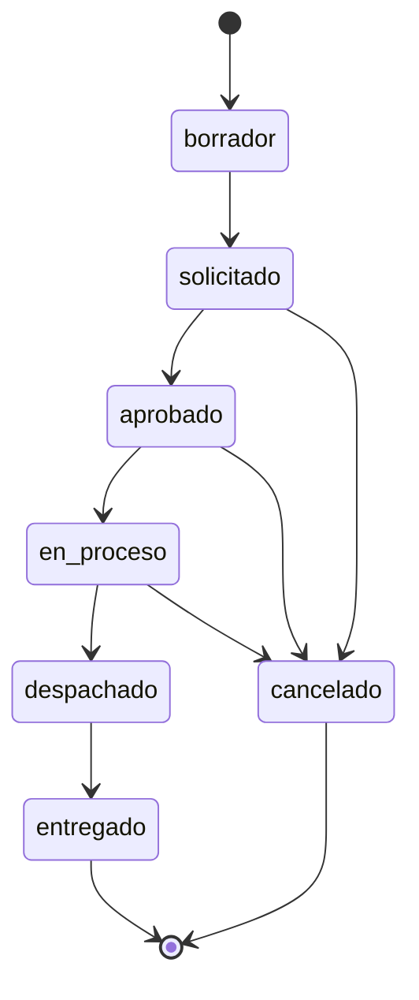

# 05 - Modelo de datos y diseño de la API

| | |
|---|---|
| **Proyecto** | TransPort |
| **Documento** | Modelo de datos conceptual y contratos de la API `/api/v1` |
| **Estado** | Borrador para revisión. Versión 0.1 |
| **Documentos relacionados** | [02-dominio](02-dominio.md), [04-arquitectura](04-arquitectura.md) |

## 1. Alcance de este documento

Define las entidades, relaciones y reglas principales del sistema, y los contratos de la API REST. El modelo es **conceptual completo**; el MVP implementa solo las entidades marcadas en la sección 4. Los nombres de campos son indicativos y pueden ajustarse al implementar.

## 2. Principios de modelado

1. **Todo dato operativo pertenece a un giro** (`business_unit_id`). Esto permite presupuestos separados y visión consolidada por agregación.
2. **Un solo modelo de pedido** para pedidos internos entre giros, de clientes y de terceros. Cambia el origen y el destino, no la estructura.
3. **Permisos por membresía**: un usuario tiene uno o más roles, cada uno asociado a un giro (o a toda la organización).
4. **Eventos como datos**: las lecturas GPS y las alertas se guardan como registros consultables y alimentan los reportes.
5. **Integridad en la base de datos**: claves foráneas, restricciones únicas y enumeraciones; la aplicación no es la única barrera.

## 3. Modelo entidad-relación

```mermaid
erDiagram
    BUSINESS_UNIT ||--o{ SITE : "tiene"
    BUSINESS_UNIT ||--o{ PRODUCT : "ofrece"
    BUSINESS_UNIT ||--o{ ASSET : "posee"
    BUSINESS_UNIT ||--o{ BUDGET : "planifica"
    BUSINESS_UNIT ||--o{ MEMBERSHIP : "agrupa"
    USER ||--o{ MEMBERSHIP : "tiene"
    CUSTOMER ||--o{ CUSTOMER_USER : "tiene"
    USER ||--o{ CUSTOMER_USER : "representa"

    SITE ||--o{ INVENTORY_ITEM : "almacena"
    PRODUCT ||--o{ INVENTORY_ITEM : "se almacena como"
    PRODUCT ||--o{ ORDER_ITEM : "se pide en"

    ORDER ||--|{ ORDER_ITEM : "contiene"
    ORDER ||--o{ ORDER_MESSAGE : "tiene hilo"
    ORDER ||--o{ ORDER_STATUS_EVENT : "registra cambios de estado"
    BUSINESS_UNIT ||--o{ ORDER : "origen (provee)"
    BUSINESS_UNIT ||--o{ ORDER : "destino interno (solicita)"
    CUSTOMER ||--o{ ORDER : "solicita"
    API_CLIENT ||--o{ ORDER : "crea"

    CUSTOMER ||--o{ MEETING : "agenda"
    BUSINESS_UNIT ||--o{ MEETING : "es el giro de interés de"
    USER ||--o{ MEETING : "vendedor asignado"

    ASSET ||--o{ GPS_EVENT : "reporta"
    ALERT_RULE ||--o{ ALERT : "genera"
    ALERT ||--o{ NOTIFICATION : "se entrega como"
    USER ||--o{ NOTIFICATION : "recibe"

    BUDGET ||--o{ EXPENSE : "registra"
    API_CLIENT ||--o{ WEBHOOK_DELIVERY : "recibe"

    BUSINESS_UNIT {
        int id PK
        string code UK
        string name
        enum type "extraccion, proceso, maquinaria, transporte_materia, transporte_producto, construccion"
    }
    SITE {
        int id PK
        int business_unit_id FK
        string name
        string department
    }
    USER {
        int id PK
        string email UK
        string name
        string password_hash
        bool active
    }
    MEMBERSHIP {
        int id PK
        int user_id FK
        int business_unit_id FK "nulo = toda la organización"
        enum role "dueno, gerente, vendedor, operativo, administrativo"
    }
    CUSTOMER {
        int id PK
        string name
        string tax_id
    }
    CUSTOMER_USER {
        int customer_id FK
        int user_id FK
    }
    PRODUCT {
        int id PK
        int business_unit_id FK
        string name
        string unit "tonelada, m2, hora, etc."
        bool public "visible en la sala de ventas"
    }
    INVENTORY_ITEM {
        int site_id FK
        int product_id FK
        decimal quantity
        decimal min_threshold
    }
    ORDER {
        int id PK
        enum kind "interno, cliente, tercero"
        int supplier_unit_id FK "giro que provee"
        int requesting_unit_id FK "solo interno"
        int customer_id FK "solo cliente"
        int api_client_id FK "solo tercero"
        enum status "borrador, solicitado, aprobado, en_proceso, despachado, entregado, cancelado"
        date due_date
        string external_ref "referencia del tercero"
        timestamp created_at
    }
    ORDER_ITEM {
        int order_id FK
        int product_id FK
        decimal quantity
    }
    ORDER_MESSAGE {
        int id PK
        int order_id FK
        int author_user_id FK
        text body
    }
    ORDER_STATUS_EVENT {
        int id PK
        int order_id FK
        enum from_status "nulo al crear el pedido"
        enum to_status
        int actor_user_id FK
        timestamp created_at
    }
    MEETING {
        int id PK
        int customer_id FK
        int business_unit_id FK "giro de interés"
        int seller_user_id FK "nulo si el giro no tiene vendedores"
        enum status "solicitada, confirmada, realizada, cancelada"
        string contact_name
        string contact_email
        string contact_phone
        text message
        date preferred_date "opcional"
        timestamp scheduled_at "se fija al confirmar"
    }
    ASSET {
        int id PK
        int business_unit_id FK
        enum kind "camion, maquinaria"
        string plate_or_code UK
        string gps_external_id UK
    }
    GPS_EVENT {
        bigint id PK
        int asset_id FK
        timestamp recorded_at
        decimal lat
        decimal lng
        decimal speed_kmh
    }
    ALERT_RULE {
        int id PK
        int business_unit_id FK "nulo = global"
        enum type "pedido_retrasado, exceso_velocidad, stock_bajo"
        jsonb params
        enum target_role
        bool active
    }
    ALERT {
        int id PK
        int rule_id FK
        int business_unit_id FK
        enum severity "info, aviso, critica"
        jsonb payload
        enum status "abierta, atendida"
        timestamp created_at
    }
    NOTIFICATION {
        int id PK
        int alert_id FK
        int user_id FK
        enum channel "app, push, correo"
        timestamp read_at
    }
    BUDGET {
        int id PK
        int business_unit_id FK
        string period
        decimal amount
    }
    EXPENSE {
        int id PK
        int budget_id FK
        string concept
        decimal amount
        date incurred_on
    }
    API_CLIENT {
        int id PK
        string name
        string key_hash
        text_array scopes
        string webhook_url
        string webhook_secret
    }
    WEBHOOK_DELIVERY {
        int id PK
        int api_client_id FK
        string event
        int attempts
        enum status "pendiente, entregado, fallido"
    }
```



### 3.1 Reglas de negocio principales

| Regla | Descripción |
|---|---|
| Pedido interno | Tiene `supplier_unit_id` y `requesting_unit_id` distintos. El giro proveedor lo aprueba. |
| Pedido de cliente | Tiene `customer_id`; el cliente solo ve sus propios pedidos. |
| Pedido de tercero | Tiene `api_client_id` y `external_ref`; la pareja (`api_client_id`, `external_ref`) es única para garantizar idempotencia. |
| Estados de pedido | Solo se permiten las transiciones válidas (por ejemplo, `solicitado → aprobado → en_proceso → despachado → entregado`); `cancelado` es posible antes de `despachado`. |
| Despacho | Al pasar un pedido a `despachado` se descuentan las existencias del giro proveedor, empezando por la sede con más existencia. Si no alcanzan, la API responde `422 INSUFFICIENT_STOCK` y el pedido conserva su estado (la operación es una sola transacción). |
| Inventario | `quantity` no puede ser negativa (restricción en la base). Si cae bajo `min_threshold`, se evalúa la regla `stock_bajo`. |
| Visibilidad de pedidos | Un pedido es visible para el dueño y para quien tiene alguna membresía en el giro proveedor o en el solicitante. Para el resto, el pedido no existe (`404`). |
| Solicitud de reunión | La hace una persona sin cuenta desde la sala de ventas. Se crea (o se reutiliza, si el NIT coincide) el cliente y se asigna al vendedor del giro de interés con menos reuniones abiertas (`solicitada` o `confirmada`); en empate, al de menor id. Si el giro no tiene vendedores queda sin asignar. |
| Protección del formulario público | Campo trampa que un humano no llena, y límite configurable de solicitudes exitosas por IP y hora (`429` con `Retry-After`). El límite en memoria sirve para un solo proceso; con varias instancias debe moverse a un almacén compartido o al WAF. |
| Privacidad de reuniones | Los datos de contacto solo los ven el vendedor asignado, el gerente del giro y el dueño. El dueño consulta pero no modifica. |
| Alertas | Cada alerta se dirige por el rol objetivo de su regla y por el giro; solo se notifica a quienes tienen membresía en ese giro (o global). |
| Presupuesto | Un presupuesto por giro y período; los gastos se acumulan contra él. |

## 4. Alcance de implementación del modelo

| Entidad | MVP | Nota |
|---|---|---|
| `USER` | Sí | Existe. |
| `MEMBERSHIP` | Sí | Implementada. Reemplazó la columna `role` de `users`; el rol `cliente` queda fuera hasta modelar `CUSTOMER`. |
| `BUSINESS_UNIT`, `SITE` | Sí | Implementadas, con datos semilla de los seis giros y sus sedes. |
| `PRODUCT`, `INVENTORY_ITEM` | Sí | Implementadas, con pocos productos semilla (catálogo provisional). |
| `ORDER`, `ORDER_ITEM`, `ORDER_MESSAGE`, `ORDER_STATUS_EVENT` | Sí | Implementadas para el pedido interno entre giros (`kind = interno`). |
| `ASSET`, `GPS_EVENT` | Sí | Alimentadas por el servicio GPS simulado. |
| `ALERT_RULE`, `ALERT`, `NOTIFICATION` | Sí | Al menos una regla real. |
| `API_CLIENT` | Sí | Para el endpoint de pedidos de terceros. |
| `CUSTOMER`, `MEETING` | Sí | Implementadas: solicitud pública de reunión, asignación de vendedor y gestión por el personal. |
| `CUSTOMER_USER` | Solo diseño | Cuentas de acceso de clientes; no hay autorregistro, la cuenta la crea la empresa. |
| `BUDGET`, `EXPENSE` | Solo diseño | Fuera del corte vertical. |
| `WEBHOOK_DELIVERY` | Solo diseño | Extra si sobra tiempo. |

## 5. Diseño de la API

### 5.1 Convenciones

| Aspecto | Convención |
|---|---|
| Base | `/api/v1`. Los cambios incompatibles introducen `/api/v2`. |
| Formato | JSON (`application/json`), campos en `camelCase`, fechas en ISO 8601 UTC. |
| Autenticación de usuarios | `Authorization: Bearer <jwt>`. Obtenido en `POST /auth/login`. |
| Autenticación de terceros | `Authorization: Bearer <api-key>` con alcances. Las rutas de terceros viven bajo `/api/v1/b2b`. |
| Validación | Esquemas Zod del lado del servidor para cuerpo, parámetros y consulta. |
| Paginación | `?page=1&pageSize=20`. La respuesta incluye `items`, `page`, `pageSize` y `total`. |
| Filtros | `?businessUnitId=`, `?status=`, `?from=&to=` según el recurso. |
| Idempotencia | Creación de pedidos de terceros con `externalRef` único por cliente; reenviar devuelve el pedido existente con `200`. |
| Límite de uso | Respuesta `429` con `Retry-After` para clientes que exceden su cuota (diseñado). |

### 5.2 Códigos HTTP

| Código | Uso |
|---|---|
| 200 / 201 / 204 | Éxito, creación, sin contenido. |
| 400 | Solicitud mal formada. |
| 401 | Falta autenticación o es inválida. |
| 403 | Autenticado sin permiso sobre el recurso o el giro. |
| 404 | Recurso inexistente (también cuando no se debe revelar su existencia). |
| 409 | Conflicto, por ejemplo transición de estado no permitida. |
| 422 | Datos válidos en formato pero que violan una regla de negocio. |
| 429 | Demasiadas solicitudes. |
| 500 | Error interno; el cuerpo no expone detalles. |

### 5.3 Formato de error

```json
{
  "error": {
    "code": "ORDER_INVALID_TRANSITION",
    "message": "No se puede pasar de 'entregado' a 'aprobado'.",
    "details": [{ "field": "status", "issue": "transición no permitida" }],
    "requestId": "b6f2c1e0-..."
  }
}
```

`code` es estable y apto para programas; `message` es legible para personas; `requestId` correlaciona con los logs. Nunca se devuelven mensajes de la base de datos ni trazas.

Todas las respuestas de error de la API usan este formato, incluidos los errores de validación (`400 VALIDATION_ERROR`, con un elemento en `details` por campo) y los de autenticación (`401 UNAUTHORIZED`, `401 INVALID_CREDENTIALS`). Cada respuesta incluye además el encabezado `X-Request-Id`, con el mismo valor que `requestId`.

### 5.4 Catálogo de endpoints

**Marca:** ✔ listo (ya implementado), ✔ MVP (incluido en el MVP, aún no implementado), ◇ solo diseñado.

**Autenticación**

| Método y ruta | Descripción | Acceso | Estado |
|---|---|---|---|
| `POST /auth/login` | Inicia sesión; devuelve token y usuario con sus membresías. | Público | ✔ listo |
| `GET /auth/me` | Usuario autenticado y sus membresías. | Autenticado | ✔ listo |
| `POST /auth/refresh` | Renueva el token. | Autenticado | ◇ |

**Catálogo y sala de ventas**

| Método y ruta | Descripción | Acceso | Estado |
|---|---|---|---|
| `GET /public/business-units` | Giros con su descripción y las localidades donde operan (`sites`). | Público | ✔ listo |
| `GET /public/products` | Productos y servicios visibles. Filtro `?businessUnitId=`. | Público | ✔ listo |
| `POST /public/meeting-requests` | Solicitud de reunión: nombre, correo, teléfono y giro de interés obligatorios; empresa, NIT, fecha preferida (hasta 180 días) y mensaje opcionales. Asigna vendedor y responde `201` sin devolver datos del cliente. | Público | ✔ listo |

**Reuniones (personal)**

| Método y ruta | Descripción | Acceso | Estado |
|---|---|---|---|
| `GET /meetings` | Solicitudes de reunión con datos de contacto. Filtro `status`. | Vendedor (las suyas), gerente (las de su giro), dueño (todas) | ✔ listo |
| `PATCH /meetings/{id}/status` | Confirma (con `scheduledAt` futuro), marca como realizada o cancela. Transiciones: `solicitada → confirmada \| cancelada`, `confirmada → realizada \| cancelada`. | Vendedor asignado o gerente del giro | ✔ listo |

**Pedidos**

| Método y ruta | Descripción | Acceso | Estado |
|---|---|---|---|
| `GET /orders` | Lista según permisos, con líneas. Filtros: `status`, `businessUnitId`, `relation` (`supplier` = "que debo atender", `requester` = "solicitados por mi giro"), `from`, `to` (hora de Guatemala). | Autenticado | ✔ listo |
| `POST /orders` | Crea un pedido interno (`status` inicial `solicitado` o `borrador`). Los pedidos de cliente y de tercero se agregarán con sus entidades. | Operativo y gerente del giro solicitante | ✔ listo |
| `GET /orders/{id}` | Detalle con líneas, historial de estados y `allowedTransitions` (acciones que el usuario puede ejecutar ahora). | Con permiso | ✔ listo |
| `PATCH /orders/{id}/status` | Cambia el estado respetando la máquina de estados y los permisos de la sección 5.6. | Según estado y lado del pedido | ✔ listo |
| `GET /orders/{id}/messages` | Hilo de comunicación del pedido. | Con permiso | ✔ listo |
| `POST /orders/{id}/messages` | Publica un mensaje (1 a 2000 caracteres). | Con permiso | ✔ listo |

**Inventario**

| Método y ruta | Descripción | Acceso | Estado |
|---|---|---|---|
| `GET /inventory` | Existencias por sede y producto, con `belowMinimum`. Cada rol ve solo los giros donde es operativo o gerente; el dueño ve todos. | Operativo, gerente, dueño | ✔ listo |
| `GET /inventory/availability?businessUnitId=` | Productos de un giro con la existencia total, sin detalle por sede. Permite pedir a otro giro sin acceder a su inventario. | Quien puede crear pedidos, dueño | ✔ listo |
| `PATCH /inventory/{siteId}/{productId}` | Fija la cantidad existente (conteo físico o recepción de material). Cantidad mayor o igual que cero. No guarda quién ni cuándo lo ajustó; la auditoría queda como mejora. | Operativo y gerente del giro dueño de la sede | ✔ listo |

**Flota y GPS**

| Método y ruta | Descripción | Acceso | Estado |
|---|---|---|---|
| `GET /assets` | Camiones y maquinaria por giro. | Con permiso | ✔ |
| `GET /assets/{id}/events` | Historial de posiciones y velocidad. | Con permiso | ✔ |
| `POST /gps/ingest` | Recibe eventos desde el servicio GPS. | Servicio interno | ✔ |

**Alertas**

| Método y ruta | Descripción | Acceso | Estado |
|---|---|---|---|
| `GET /alerts` | Alertas dirigidas al usuario. | Autenticado | ✔ |
| `PATCH /alerts/{id}` | Marca como atendida. | Destinatario | ✔ |
| `GET /alert-rules` · `PUT /alert-rules/{id}` | Consulta y configura reglas. | Gerente, dueño | ◇ |

**Reportes y panel**

| Método y ruta | Descripción | Acceso | Estado |
|---|---|---|---|
| `GET /reports/overview` | Indicadores consolidados de todos los giros. | Dueño | ✔ |
| `GET /reports/business-units/{id}` | Panel de un giro: pedidos por estado y retrasados como proveedor y como solicitante, los cinco pedidos más urgentes por atender, existencias bajo el mínimo y, solo para gerente y dueño, conteo de reuniones por confirmar. Un pedido está retrasado si su fecha requerida pasó y sigue en `solicitado`, `aprobado` o `en_proceso` (fecha en hora de Guatemala). | Gerente y operativo del giro, dueño | ✔ listo |
| `GET /reports/customers/{id}` | Estado de la relación de un cliente con cada giro. | Cliente, vendedor | ◇ |
| `GET /reports/{type}/export?format=csv` | Exportación. | Con permiso | ◇ |

**Presupuesto**

| Método y ruta | Descripción | Acceso | Estado |
|---|---|---|---|
| `GET/POST /budgets`, `POST /budgets/{id}/expenses` | Presupuesto y gastos por giro. | Administrativo, gerente | ◇ |

**API B2B (terceros)**

| Método y ruta | Descripción | Acceso | Estado |
|---|---|---|---|
| `POST /b2b/orders` | Crea un pedido; idempotente por `externalRef`. | API key con alcance `orders:write` | ✔ |
| `GET /b2b/orders/{id}` | Estado de un pedido propio. | `orders:read` | ✔ |
| `GET /b2b/orders?updatedSince=` | Consulta incremental. | `orders:read` | ◇ |
| Webhooks salientes | `order.status_changed`, firmados con HMAC-SHA256 en `X-TransPort-Signature`. | Configurado por cliente | ◇ |
| Importación CSV/EDI | Carga masiva de pedidos por archivo. | `orders:write` | ◇ |

### 5.5 Ejemplo: creación de un pedido interno

Solicitud:

```http
POST /api/v1/orders
Authorization: Bearer <jwt>
Content-Type: application/json

{
  "kind": "interno",
  "supplierUnitId": 1,
  "requestingUnitId": 2,
  "dueDate": "2026-11-05",
  "items": [{ "productId": 10, "quantity": 120 }]
}
```

Respuesta `201`:

```json
{
  "id": 341,
  "kind": "interno",
  "status": "solicitado",
  "supplierUnitId": 1,
  "supplierUnitName": "Extracción minera",
  "requestingUnitId": 2,
  "requestingUnitName": "Proceso de materia prima",
  "dueDate": "2026-11-05",
  "createdAt": "2026-10-20T15:04:11.000Z",
  "items": [{ "productId": 10, "productName": "Piedra caliza en bruto", "unit": "tonelada", "quantity": 120 }],
  "history": [{ "fromStatus": null, "toStatus": "solicitado", "actorName": "L. Pérez", "createdAt": "2026-10-20T15:04:11.000Z" }],
  "allowedTransitions": []
}
```

`allowedTransitions` lista los estados a los que el usuario autenticado puede llevar el pedido ahora. Para quien solicitó el pedido está vacía; para el gerente del giro proveedor contiene `aprobado` y `cancelado`. La interfaz la usa para mostrar solo los botones que corresponden.

### 5.6 Máquina de estados del pedido



Quién puede ejecutar cada transición. El **proveedor** es el giro que provee el producto y el **solicitante** el que lo pide; los roles se evalúan con las membresías del usuario en el giro correspondiente.

| Transición | Lado | Roles |
|---|---|---|
| `borrador → solicitado` | Solicitante | Operativo, gerente |
| `solicitado → aprobado` | Proveedor | Gerente |
| `aprobado → en_proceso` | Proveedor | Operativo, gerente |
| `en_proceso → despachado` | Proveedor | Operativo, gerente (descuenta existencias) |
| `despachado → entregado` | Solicitante | Operativo, gerente (confirma la recepción) |
| `solicitado`, `aprobado` o `en_proceso` `→ cancelado` | Proveedor o solicitante | Gerente |

Una transición que no está en el diagrama responde `409 ORDER_INVALID_TRANSITION`, aunque el usuario tenga permisos. Una transición válida sin permiso responde `403 FORBIDDEN`.

## 6. Contrato del servicio GPS simulado

GPS-Inversiones no publica una API conocida para este proyecto. Se **asume** el siguiente contrato mínimo, que el servicio simulado implementa y que debe validarse con el proveedor antes de integrar el servicio real.

| Elemento | Detalle |
|---|---|
| Dispositivo | Identificador externo (`gpsExternalId`) relacionado con `ASSET.gps_external_id`. |
| Evento | `{ deviceId, recordedAt, lat, lng, speedKmh }`. |
| Entrega | El servicio simulado envía eventos a `POST /gps/ingest` con un token de servicio. En producción puede ser consulta periódica a la API del proveedor. |
| Regla de ejemplo | `exceso_velocidad`: alerta crítica al gerente y operativos del giro si `speedKmh` supera `params.maxSpeedKmh` para un camión. |

## 7. Decisiones pendientes

- Estrategia de migraciones en producción (herramienta de Drizzle frente a scripts SQL versionados). En desarrollo se usa `drizzle-kit push`.
- Catálogo definitivo de productos semilla por giro.
- Canal real de notificaciones (push/correo) para la propuesta de producción.
