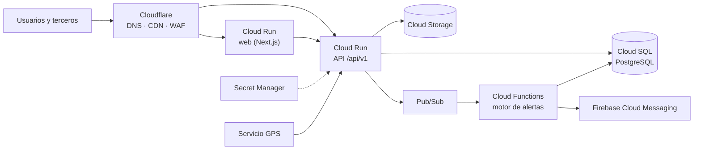

# 06 - Tecnología e infraestructura

| | |
|---|---|
| **Proyecto** | TransPort |
| **Documento** | Entorno local, comparación de alternativas y propuesta de infraestructura en la nube |
| **Estado** | Versión 0.3. Estimación de costos en [09-costos-nube](09-costos-nube.md) |
| **Documentos relacionados** | [03-alcance](03-alcance.md), [04-arquitectura](04-arquitectura.md), [09-costos-nube](09-costos-nube.md) |

## 1. Alcance de este documento

Describe el entorno de ejecución local con Docker Compose, resume las alternativas tecnológicas evaluadas y presenta la **propuesta de infraestructura en la nube** (requisito RNF-03). La justificación formal de cada decisión se encuentra en los ADR de [04-arquitectura](04-arquitectura.md): ADR-002 (API), ADR-003 (base de datos), ADR-005 (almacenamiento) y ADR-008 (contenedores y nube).

La nube es una **propuesta hipotética justificada**; no se realiza un despliegue real. El sistema se demuestra íntegramente en el entorno local.

## 2. Entorno local

El archivo `docker-compose.yml` levanta los servicios necesarios con un solo comando. Los secretos se leen de un archivo `.env` (plantilla en `.env.template`).

| Servicio | Imagen o compilación | Puerto | Función |
|---|---|---|---|
| `db` | `postgres:17-alpine` | 5432 | Base de datos relacional, con volumen persistente y comprobación de salud. |
| `storage` | `chrislusf/seaweedfs` | 8333 | Almacenamiento de objetos con protocolo S3. |
| `api` | `./apps/api` | 4000 | API REST `/api/v1` (Bun, Hono, Drizzle). Espera a que `db` esté sana. |
| `web` | `./apps/web` | 3000 | Aplicación web (Next.js) que consume la API. |

## 3. Alternativas evaluadas

### 3.1 Entorno de ejecución del backend

| Opción | A favor | En contra | Resultado |
|---|---|---|---|
| Node.js | Mayor ecosistema (Fastify, NestJS, Express); es lo visto en clase. | Arranque más lento que Bun; TypeScript requiere compilación. | Descartada |
| **Bun** | Rápido, TypeScript nativo, servidor y ejecutor de pruebas integrados. | Más joven; algunos paquetes nativos pueden fallar. | **Elegida** |
| Deno | Seguridad por permisos, TypeScript nativo, estándares web. | Ecosistema menor y menos soporte en clase. | Descartada |

### 3.2 Frontend

| Opción | Uso | Resultado |
|---|---|---|
| **Next.js** | Sitio público con SEO y renderizado en servidor, más portales por rol en una sola aplicación. | **Elegida** |
| Vite + React | SPA ligera para la intranet; PWA sencilla con `vite-plugin-pwa`. | Descartada |

El enunciado pide evitar Bootstrap genérico; se utiliza Tailwind CSS.

### 3.3 Base de datos y servicios

| Opción | Observaciones | Resultado |
|---|---|---|
| **PostgreSQL en contenedor** | Control total y sencillez en Docker Compose. Los datos son relacionales (giros, pedidos, inventario, presupuestos). | **Elegida** |
| Supabase | Agrega autenticación, tiempo real y almacenamiento sobre PostgreSQL, pero oculta el modelo de permisos que se desea demostrar. | Descartada |
| Firebase | Orientada a documentos (NoSQL), con peor ajuste a datos relacionales. Útil únicamente para notificaciones push (FCM). | Solo FCM, en la propuesta |

### 3.4 Proveedores de nube

| Opción | Perfil | Observaciones |
|---|---|---|
| AWS | Oferta más completa (ECS Fargate, RDS, S3, SES, SNS, CloudFront). | Más servicios y mayor curva de aprendizaje; costo difícil de predecir. |
| **GCP** | Cloud Run (contenedores), Cloud SQL, Cloud Storage, Pub/Sub, FCM. | Cloud Run encaja con Docker; punto medio entre simplicidad y escala. |
| Cloudflare | CDN, WAF, DNS, R2, Workers. | Sirve de frente y protección; no reemplaza el backend ni la base de datos. |
| DigitalOcean | Droplets o App Platform, PostgreSQL administrado, Spaces. | Mayor control y precio predecible; menos servicios gestionados. |
| Azure | Container Apps, PostgreSQL administrado. | Alternativa válida, menos relevante para este caso. |

Criterios de decisión: costo mensual estimado, facilidad de operación por una sola persona, escalabilidad a seis giros y a terceros, latencia desde Guatemala y capacidad de sustentar el diagrama de componentes.

## 4. Propuesta de infraestructura en producción

Se propone una **nube principal (Google Cloud)** con **Cloudflare** al frente. Se descarta una arquitectura multi-nube porque añade costo operativo sin beneficio claro para un equipo de una persona.

| Componente | Servicio propuesto | Equivalente local |
|---|---|---|
| Aplicación web (Next.js) | Cloud Run | Contenedor `web` |
| API | Cloud Run | Contenedor `api` |
| Base de datos | Cloud SQL para PostgreSQL | Contenedor `db` |
| Almacenamiento de objetos | Cloud Storage (R2 como alternativa) | Contenedor `storage` (SeaweedFS) |
| Motor de alertas y eventos | Cloud Functions con Pub/Sub | Tarea programada dentro de la API |
| Notificaciones push | Firebase Cloud Messaging | No se implementa en el MVP |
| Secretos | Secret Manager | Archivo `.env` |
| DNS, CDN y WAF | Cloudflare | No aplica |

### 4.1 Justificación

- **Cloud Run** ejecuta los mismos contenedores que se usan en desarrollo, sin servidores que administrar y con escalamiento a cero cuando no hay tráfico.
- **Cloud SQL** ofrece PostgreSQL administrado con respaldos, evitando reescribir la capa de datos.
- **Pub/Sub y Cloud Functions** permiten separar el motor de alertas sin cambiar su contrato (ADR-006).
- **Cloudflare** protege la superficie pública y reduce la latencia del sitio de ventas mediante caché.

### 4.2 Aspectos que no se resuelven en esta propuesta

- Respaldos, recuperación ante desastres y retención de datos.
- Observabilidad (registros centralizados, métricas y trazas).
- Cumplimiento normativo aplicable a los datos de clientes.

## 5. Estimación de costos

El detalle (supuestos de carga, precios unitarios con su fuente y estado de verificación, sensibilidad y diagramas) está en [09-costos-nube](09-costos-nube.md). Resumen, en dólares estadounidenses por mes:

| Escenario | Usuarios | Flota con GPS | Costo mensual estimado |
|---|---:|---:|---:|
| A. Piloto | 25 | 10 | 51.23 |
| B. Operación inicial | 80 | 40 | 53.23 |
| C. Operación completa (con alta disponibilidad) | 250 | 120 | 249.44 |

Cloud SQL representa entre el 86 % y casi el 100 % del costo; los servicios que cobran por uso caben en gran parte en las franjas gratuitas. Es una estimación de orden de magnitud con supuestos hipotéticos; el precio de Cloud SQL debe validarse en la calculadora oficial.
