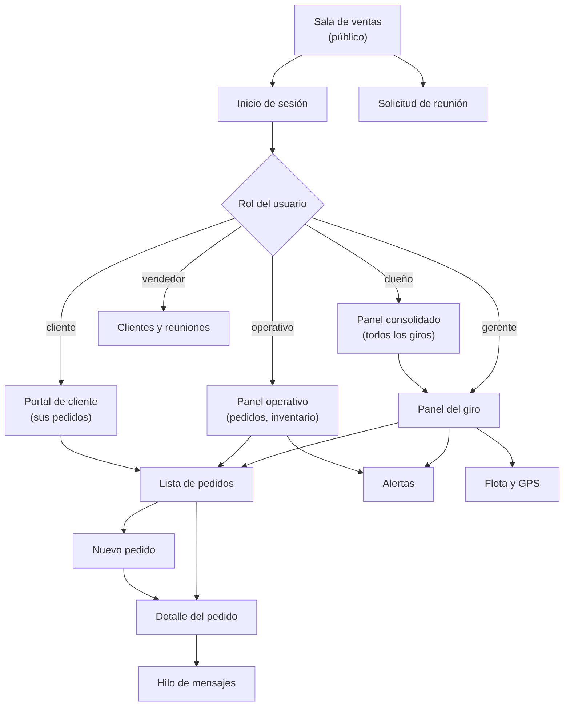
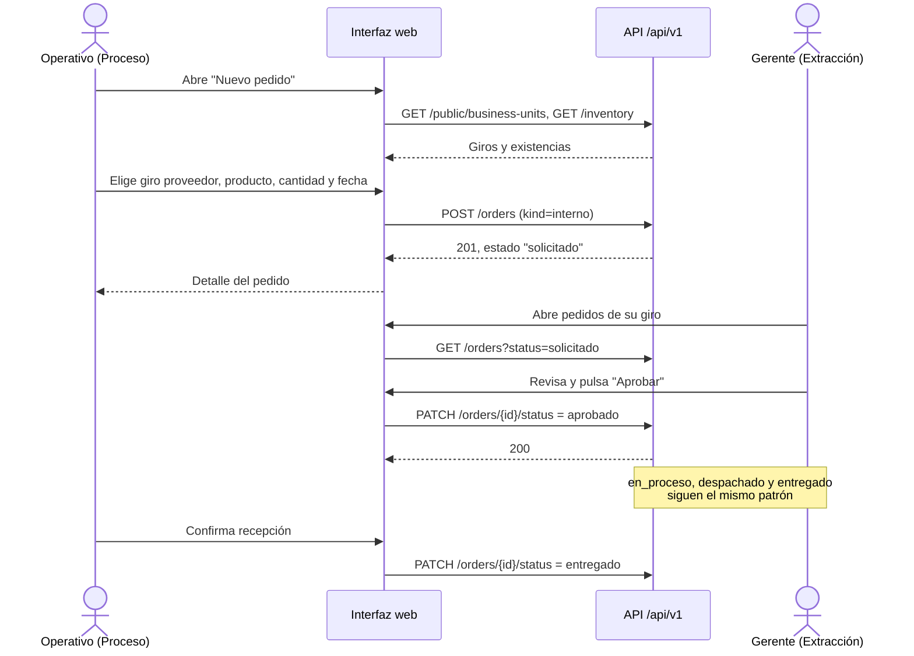

# 07 - Diseño de interfaz y wireframes

| | |
|---|---|
| **Proyecto** | TransPort |
| **Documento** | Mapa de navegación, flujos y wireframes de baja fidelidad |
| **Estado** | Borrador para revisión. Versión 0.1 |
| **Documentos relacionados** | [03-alcance](03-alcance.md), [05-datos-y-apis](05-datos-y-apis.md) |

## 1. Alcance de este documento

Define cómo se navega el sistema y cómo se ve cada pantalla del corte vertical (MVP). Los wireframes son de **baja fidelidad**: muestran estructura y contenido, no color, tipografía ni identidad visual. El diseño visual definitivo se resuelve al implementar con Tailwind.

El flujo que se detalla es el **pedido interno entre giros** (proceso solicita a extracción), que es el definido como MVP en [03-alcance](03-alcance.md).

## 2. Principios de interfaz

1. **Una sola aplicación con zonas por rol** (sitio público, portal de cliente, intranet). El menú muestra solo lo que el rol puede usar.
2. **El giro siempre visible.** Toda pantalla de intranet indica el giro activo, porque los datos y permisos dependen de él.
3. **Estado a la vista.** Los estados del pedido se muestran como etiquetas con el mismo texto que usa la API (`solicitado`, `aprobado`, etc.).
4. **Acciones según permiso.** Un botón que el rol no puede ejecutar no se muestra; la API sigue validando (403).
5. **Móvil primero para operativos.** El operativo trabaja en campo; sus pantallas deben usarse con una mano en pantalla pequeña (PWA).

## 3. Mapa de navegación

## 4. Flujo del pedido interno

## 5. Inventario de pantallas

| Id | Pantalla | Roles | Endpoints principales | Wireframe |
|---|---|---|---|---|
| P01 | Inicio de sesión | Todos | `POST /auth/login`, `GET /auth/me` | Sí |
| P02 | Panel del giro | Gerente, dueño | `GET /reports/business-units/{id}`, `GET /alerts` | Sí |
| P03 | Lista de pedidos | Según permiso | `GET /orders` | Sí |
| P04 | Nuevo pedido interno | Operativo, gerente | `POST /orders`, `GET /inventory` | Sí |
| P05 | Detalle y aprobación | Con permiso | `GET /orders/{id}`, `PATCH /orders/{id}/status`, mensajes | Sí |
| P06 | Panel consolidado | Dueño | `GET /reports/overview` | Sí |
| P07 | Alertas | Gerente, operativo | `GET /alerts`, `PATCH /alerts/{id}` | Sí |
| P08 | Sala de ventas y reunión | Público | `GET /public/*`, `POST /public/meeting-requests` | Sí |
| P09 | Flota y GPS | Gerente, operativo | `GET /assets`, `GET /assets/{id}/events` | Sí |

## 6. Especificación de las pantallas con wireframe

Los wireframes están en `docs/wireframes/wireframes.html` (se abre en el navegador) y se presentan también como artifact. A continuación se resume el contenido de cada uno.

### P01 Inicio de sesión

- Campos: correo, contraseña. Botón "Ingresar".
- Error de credenciales: mensaje genérico, sin indicar cuál campo falló (respuesta `401`).
- Tras el ingreso, redirige al panel que corresponde al rol.

### P02 Panel del giro

- Encabezado con giro activo y usuario.
- Indicadores: pedidos abiertos, pedidos retrasados, alertas abiertas, existencias bajo el mínimo.
- Tabla de pedidos recientes y lista de alertas.

### P03 Lista de pedidos

- Filtros por estado y por fecha. Pestañas "Solicitados por mi giro" y "Que debo atender".
- Columnas: número, giro proveedor, giro solicitante, fecha requerida, estado.

### P04 Nuevo pedido interno

- Giro solicitante (fijo, el del usuario) y giro proveedor (lista).
- Líneas de producto con cantidad y unidad; se muestra la existencia disponible del proveedor.
- Fecha requerida. Acciones: "Guardar borrador" y "Solicitar".
- Validaciones: proveedor distinto del solicitante, cantidad mayor que cero (error `422`).

### P05 Detalle y aprobación

- Datos del pedido, líneas y línea de tiempo de estados.
- Botones de transición según rol y estado actual (por ejemplo, "Aprobar" y "Cancelar" para el gerente proveedor cuando el estado es `solicitado`).
- Hilo de mensajes del pedido.

### P06 Panel consolidado del dueño

- Selector de período (por defecto, el mes en curso).
- Indicadores totales de los seis giros: pedidos abiertos, retrasados, alertas abiertas y entregados en el mes.
- Tabla con una fila por giro (abiertos, retrasados, alertas, activos en ruta) y una columna de situación (`normal`, `vigilar`, `atención`). Cada fila abre el panel del giro (P02).
- Gráfica de barras de pedidos abiertos por giro, para detectar cuellos de botella entre giros.
- Lista de alertas críticas con enlace a la pantalla de alertas.
- Espacio reservado para presupuesto frente a gasto, solo diseñado (`BUDGET` y `EXPENSE` no se implementan en el MVP).

### P07 Alertas

- Pestañas "Abiertas" y "Atendidas"; filtros por severidad (`info`, `aviso`, `critica`) y por tipo de regla.
- Solo se listan las alertas dirigidas al rol y al giro del usuario (notificación en la aplicación; push y correo quedan como propuesta).
- La severidad se indica con una franja y con una etiqueta de texto, para no depender solo del color.
- Panel de detalle con los datos que originaron la alerta y enlaces al camión o al pedido relacionado.
- "Marcar como atendida" disponible solo para el destinatario.
- La edición de reglas (`GET/PUT /alert-rules`) queda solo diseñada.

### P08 Sala de ventas y solicitud de reunión

- Sitio público, sin inicio de sesión. El acceso "Ingresar" lleva a P01.
- Presentación de los seis giros con una línea de descripción, obtenida de la API.
- Catálogo de productos y servicios marcados como públicos (`public`), con filtro por giro.
- Formulario de solicitud de reunión: nombre, empresa y NIT, correo, teléfono, giro de interés, fecha preferida y descripción de la necesidad.
- Al enviar se crea una reunión en estado `solicitada` y se asigna un vendedor. La confirmación indica que un vendedor contactará al solicitante, sin comprometer una fecha.

### P09 Flota y GPS

- Filtros por tipo de activo (camión, maquinaria) y por estado (`en ruta`, `detenido`, `activa`, `exceso`, `sin señal`).
- Mapa con la última posición de cada activo y lista lateral con velocidad y antigüedad de la lectura. El mapa se dibuja como marcador de posición; su implementación requiere una librería de mapas.
- Gráfica de velocidad del activo elegido frente al límite de la regla `exceso_velocidad`, la misma lectura que genera la alerta de P07.
- Tabla de las últimas lecturas (`GPS_EVENT`): hora, latitud, longitud y velocidad.
- Un activo sin lecturas recientes se marca "sin señal". Los datos provienen del servicio GPS simulado descrito en [05-datos-y-apis](05-datos-y-apis.md), sección 6.

## 7. Decisiones pendientes

- Identidad visual (paleta, tipografía) para la implementación con Tailwind.
- Si el panel del dueño incluye gráficas desde el MVP o solo cifras.
- Textos finales de los estados en español para mostrar al usuario.
