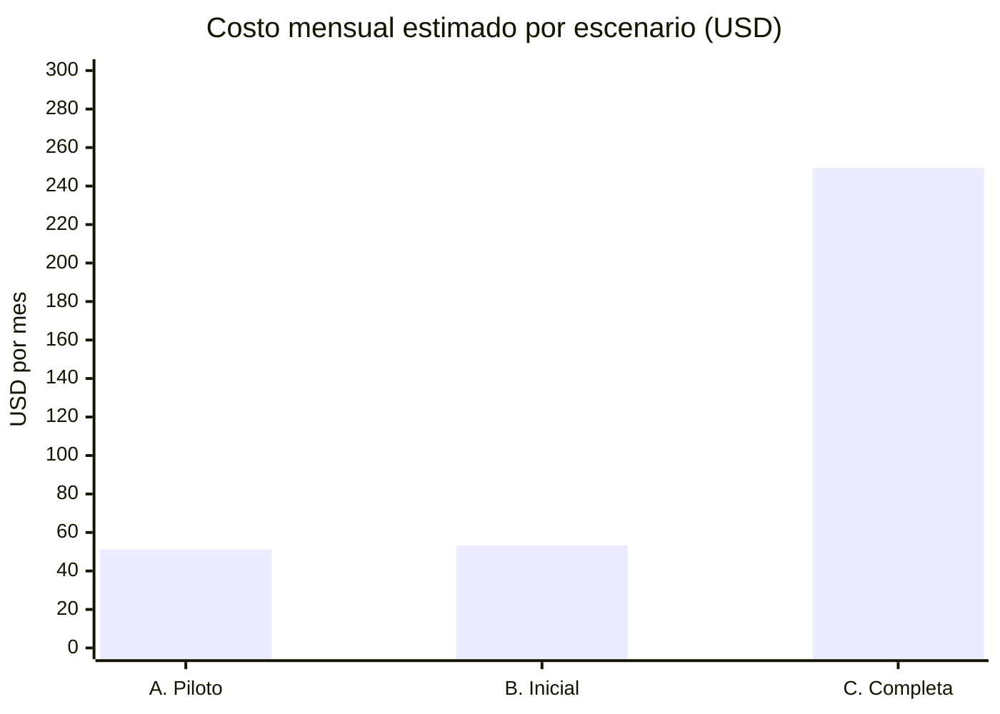
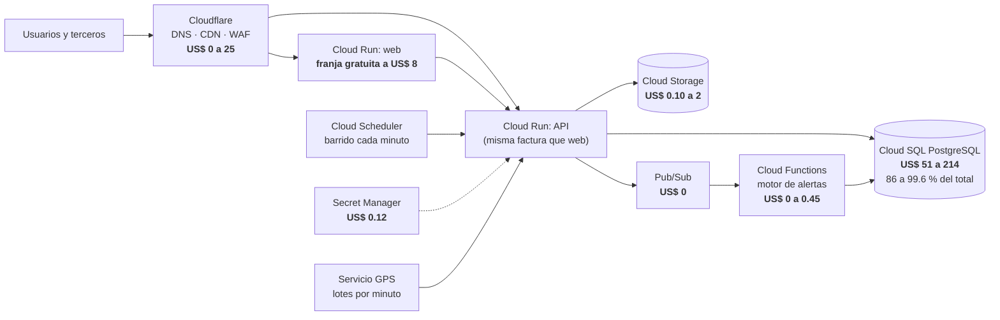
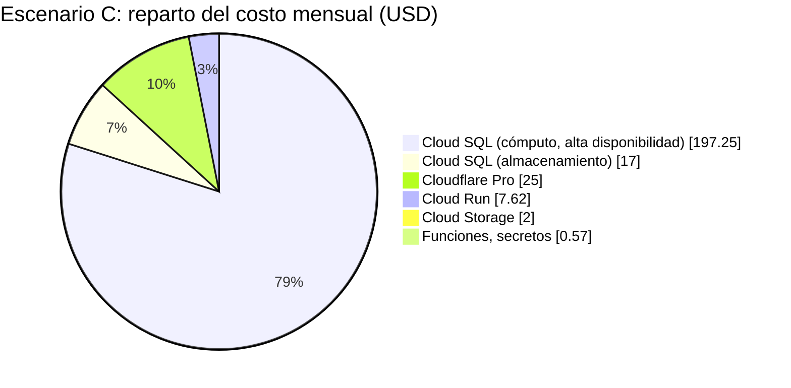
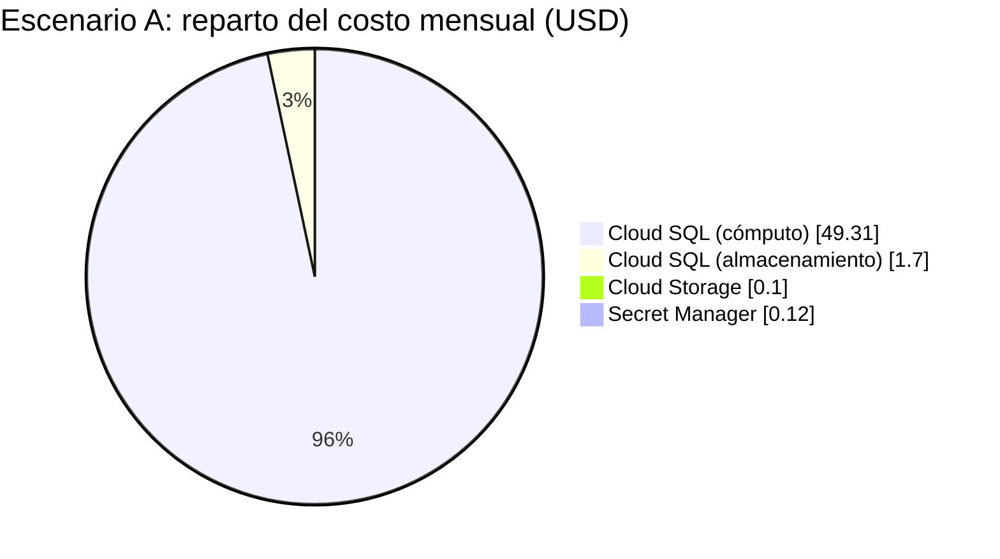
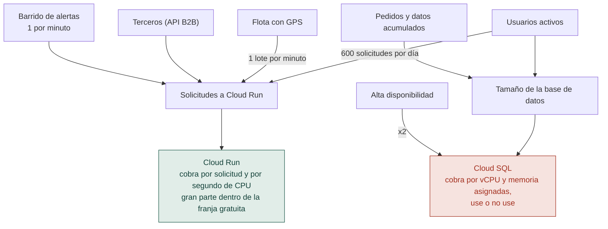

# 09 - Estimación de costos de la propuesta de nube

| | |
|---|---|
| **Proyecto** | TransPort |
| **Documento** | Costo mensual estimado de la infraestructura propuesta en [06-infraestructura](06-infraestructura.md) |
| **Estado** | Versión 1.0. Estimación de orden de magnitud con supuestos explícitos |
| **Fecha de los precios** | 22 de octubre de 2026 |
| **Documentos relacionados** | [04-arquitectura](04-arquitectura.md), [06-infraestructura](06-infraestructura.md) |

## 1. Resumen

La propuesta (Google Cloud con Cloudflare al frente) cuesta **entre unos US$ 51 y US$ 250 al mes**, según el tamaño de la operación. El resultado más importante para la decisión es la forma del costo:

- **La base de datos administrada (Cloud SQL) es casi todo el gasto**: entre el 86 % y casi el 100 % del total, según el escenario (99.6 % en el piloto, 99 % en el escenario B y 86 % en el C).
- **Los servicios que cobran por uso (Cloud Run, Pub/Sub, funciones, almacenamiento) cuestan centavos o unos pocos dólares**, porque la carga de una empresa de este tamaño cabe en gran parte dentro de las franjas gratuitas.
- **El costo crece por saltos de capacidad de la base de datos, no por usuarios**: pasar de 25 a 80 usuarios casi no cambia la factura.

| Escenario | Usuarios activos | Flota con GPS | Pedidos por día | **Costo mensual** |
|---|---:|---:|---:|---:|
| A. Piloto | 25 | 10 vehículos | 40 | **US$ 51.23** |
| B. Operación inicial | 80 | 40 vehículos | 200 | **US$ 53.23** |
| C. Operación completa | 250 | 120 vehículos | 600 | **US$ 249.44** |

> **Alcance de la cifra.** Es una estimación de orden de magnitud para sustentar la propuesta, no una cotización. Los supuestos de carga son hipotéticos (el proyecto no tiene operación real) y la sección 5 indica qué precios están confirmados con la página oficial y cuáles deben revisarse en la calculadora antes de comprometer un presupuesto. Las cifras están en dólares estadounidenses y no se convierten a quetzales porque el tipo de cambio no se verificó.

## 2. Arquitectura y dónde se gasta

Qué cambia respecto del entorno local, con efecto en el costo:

- **El barrido de alertas debe salir del proceso de la API.** En el MVP corre dentro de la API cada 60 segundos; en Cloud Run, que escala a cero, ese temporizador no se ejecutaría. En la estimación se supone un trabajo programado externo (Cloud Scheduler) que llama a la API una vez por minuto, lo que cuenta como solicitudes.
- **La ingesta de GPS debe enviarse por lotes.** El contrato (`POST /gps/ingest`) admite hasta 500 lecturas por solicitud. La estimación base supone un lote por minuto; la sección 6 muestra cuánto cambia si cada lectura fuera una solicitud.

## 3. Supuestos de carga

Todos los valores son hipotéticos y se eligieron para cubrir un rango razonable de la empresa descrita en el caso; deben reemplazarse por datos reales si se llega a operar.

| Supuesto | A. Piloto | B. Inicial | C. Completa |
|---|---:|---:|---:|
| Usuarios activos (personal de los giros) | 25 | 80 | 250 |
| Vehículos y equipos con GPS | 10 | 40 | 120 |
| Pedidos por día | 40 | 200 | 600 |
| Solicitudes de terceros (API B2B) por día | 0 | 0 | 3,000 |
| Volumen de datos en la base | 10 GB | 20 GB | 50 GB |
| Archivos en almacenamiento de objetos | 5 GB | 20 GB | 100 GB |

Supuestos comunes:

| Supuesto | Valor | Razón |
|---|---|---|
| Días laborales por mes | 22 | Uso del personal entre semana. |
| Solicitudes a la API por usuario y día | 600 | Incluye el sondeo automático de alertas (cada minuto) y de la flota (cada 30 segundos). |
| Cargas de página por usuario y día | 100 | Navegación entre pantallas. |
| Lecturas GPS | 2 por minuto y vehículo, 12 horas al día, 30 días | Equivale a 432 mil, 1.7 millones y 5.2 millones de lecturas al mes. |
| Barridos de alertas | 1 por minuto (43,200 al mes) | Ver sección 2. |
| Tiempo facturado por solicitud | 0.1 s en la API, 0.2 s en la web, 0.3 s en el barrido | Cloud Run redondea cada solicitud a 100 ms. Es un límite superior: con concurrencia varias solicitudes comparten tiempo de instancia. |
| Tamaño de instancia | 1 vCPU y 0.5 GiB | Suficiente para la API en Bun y la web en Next.js. |
| Horas por mes | 730 | Convención de las calculadoras. |

## 4. Costo por componente

Cifras en US$ por mes. Las fórmulas están en la sección 5; el cálculo completo se puede reproducir con los precios de esa sección.

| Componente | Dimensionamiento | A. Piloto | B. Inicial | C. Completa |
|---|---|---:|---:|---:|
| Cloud Run (web y API) | Solicitudes: 0.45 M, 1.30 M, 4.00 M. vCPU-s: 59 mil, 156 mil, 464 mil | 0.00 | 0.00 | 7.62 |
| Cloud SQL: cómputo | A y B: 1 vCPU y 3.75 GB. C: 2 vCPU y 7.5 GB con alta disponibilidad (duplica el cómputo) | 49.31 | 49.31 | 197.25 |
| Cloud SQL: almacenamiento SSD | 10, 20 y 50 GB (el doble en alta disponibilidad) | 1.70 | 3.40 | 17.00 |
| Cloud Storage | 5, 20 y 100 GB (almacenamiento estándar) | 0.10 | 0.40 | 2.00 |
| Pub/Sub | 0.05, 0.09 y 0.18 GiB al mes, dentro de los 10 GiB gratuitos | 0.00 | 0.00 | 0.00 |
| Cloud Functions (motor de alertas) | 26 mil, 46 mil y 94 mil invocaciones (2 millones gratuitas) | 0.00 | 0.00 | 0.45 |
| Secret Manager | 8 secretos; los 6 primeros sin costo | 0.12 | 0.12 | 0.12 |
| Cloudflare | Free en A y B; Pro en C | 0.00 | 0.00 | 25.00 |
| Firebase Cloud Messaging | Notificaciones push (no implementadas en el MVP) | 0.00 | 0.00 | 0.00 |
| **Total** | | **51.23** | **53.23** | **249.44** |

### 4.1 De la carga a la factura

La diferencia explica por qué el costo no sigue a los usuarios: Cloud Run factura lo que se usa y la franja gratuita absorbe la carga pequeña, mientras que Cloud SQL factura la capacidad reservada de forma continua.

## 5. Precios unitarios y su verificación

Los precios se consultaron el 22 de octubre de 2026. Las páginas de precios de Google cargan su contenido de forma dinámica y no pudieron leerse completas con la herramienta usada, por lo que los valores se tomaron de lo que la búsqueda devolvió de esas páginas oficiales y, donde no apareció, de fuentes de terceros. La columna de verificación lo indica con claridad.

| Servicio | Precio usado | Verificación |
|---|---|---|
| [Cloud Run](https://cloud.google.com/run/pricing), facturación por solicitud, región de nivel 1 | CPU: US$ 0.000024 por vCPU-segundo. Memoria: US$ 0.0000025 por GiB-segundo. Solicitudes: US$ 0.40 por millón. Gratis cada mes: 180,000 vCPU-s, 360,000 GiB-s y 2 millones de solicitudes | Confirmado en la página oficial |
| [Pub/Sub](https://cloud.google.com/pubsub/pricing) | US$ 40 por TiB entregado; los primeros 10 GiB al mes sin costo | Confirmado en la página oficial |
| [Cloud Storage](https://cloud.google.com/storage/pricing) | Estándar en us-central1: US$ 0.020 por GB al mes | Confirmado en la página oficial. El costo de las operaciones (clases A y B) no se confirmó y se omite por ser insignificante con este volumen |
| [Cloud Functions](https://cloud.google.com/functions/pricing-1stgen) | 2 millones de invocaciones gratis; luego US$ 0.40 por millón | Confirmado en la página de la 1.ª generación. Para la 2.ª generación se aplicó la tarifa de Cloud Run al tiempo de cómputo (solo C, unos US$ 0.45) |
| [Secret Manager](https://cloud.google.com/secret-manager) | US$ 0.06 por versión activa al mes (6 gratis); US$ 0.03 por 10,000 accesos | Confirmado en la página oficial |
| [Cloudflare](https://www.cloudflare.com/plans/network-cdn.md) | Free: US$ 0. Pro: US$ 25 al mes (US$ 20 con pago anual). Business: US$ 250 al mes (US$ 200 anual) | Confirmado en la página oficial. La página lista WAF, protección DDoS y CDN en los tres planes sin detallar el alcance de cada uno |
| [Cloud SQL para PostgreSQL](https://cloud.google.com/sql/pricing), edición Enterprise, us-central1 | vCPU: US$ 0.0413 por hora. Memoria: US$ 0.007 por GB por hora. SSD: US$ 0.17 por GB al mes. Alta disponibilidad: el doble de cómputo y almacenamiento | **Sin confirmar en la página vigente.** Coincide entre dos fuentes de terceros fechadas en 2026 ([ComputingForGeeks](https://computingforgeeks.com/gcp-cloud-sql-postgresql-terraform/), [Bytebase](https://www.bytebase.com/dbcost/cloudsql-pricing/)) y con el SSD de la página de producto de Google, pero es el componente que más pesa: **verificarlo en la calculadora oficial antes de presentar cifras como definitivas** |
| Firebase Cloud Messaging | Sin costo por mensaje | No verificado en esta sesión; las notificaciones push no están implementadas |

Herramienta para validar y refinar: [calculadora oficial de precios de Google Cloud](https://cloud.google.com/products/calculator).

Fórmulas principales (730 horas al mes):

- Cloud SQL, cómputo: `(vCPU × 0.0413 + GB de memoria × 0.007) × 730`, multiplicado por 2 con alta disponibilidad. Para 1 vCPU y 3.75 GB: 0.06755 × 730 = US$ 49.31.
- Cloud SQL, almacenamiento: `GB × 0.17`, multiplicado por 2 con alta disponibilidad.
- Cloud Run: `max(0, vCPU-s − 180,000) × 0.000024 + max(0, GiB-s − 360,000) × 0.0000025 + max(0, solicitudes − 2,000,000) ÷ 1,000,000 × 0.40`.

### 5.1 Lo que no está incluido

| Concepto | Por qué se omite |
|---|---|
| Transferencia de salida a internet | No se confirmó la tarifa. Con Cloudflare en caché al frente y respuestas JSON pequeñas se espera un monto bajo, pero debe calcularse en la calculadora con el tráfico real. |
| Almacenamiento de respaldos de Cloud SQL | Tarifa no confirmada; depende de la política de retención. |
| Imágenes de contenedor, registros y monitoreo más allá de la franja gratuita | Dependen de la operación real. |
| Operaciones de Cloud Storage y Cloud Scheduler | Volumen insignificante; la tarifa de Scheduler no se verificó (se supone dentro de los trabajos gratuitos). |
| Dominio, impuestos y plan de soporte | Fuera del alcance de la comparación. |
| Instancia mínima en Cloud Run | Evitaría arranques en frío a cambio de pagar CPU en reposo (el precio de la CPU en reposo es US$ 0.0000025 por vCPU-segundo; el de la memoria en reposo no se confirmó). |

## 6. Sensibilidad: qué mueve el costo

| Variación | Efecto mensual | Lectura |
|---|---|---|
| Enviar cada lectura GPS como una solicitud, en lugar de un lote por minuto | B: +US$ 3.92. C: +US$ 14.78 (de 249.44 a 264.22) | La ingesta por lotes es la decisión de diseño que más reduce el costo de Cloud Run. |
| Usar una instancia compartida (db-g1-small, US$ 0.035 por hora) en el piloto | A: −US$ 23.76 (cómputo de 49.31 a 25.55) | Sin garantía de disponibilidad (SLA) y no recomendada por Google para producción; válida solo para una demostración o un piloto interno. Precio de página de Google de antigüedad incierta. |
| Quitar la alta disponibilidad en el escenario C | C: unos −US$ 98.63 en cómputo y −US$ 8.50 en almacenamiento | Ahorro grande a cambio de aceptar una interrupción si falla la zona. Es una decisión de negocio. |
| Plan anual de Cloudflare Pro | C: −US$ 5 | US$ 20 en lugar de 25 al mes. |
| Descuentos por compromiso de uso en Cloud SQL | No estimado | Existen para cómputo y memoria de Cloud SQL, excepto instancias compartidas; el porcentaje no se verificó. |

## 7. Recomendaciones

1. **Empezar en el escenario A** y crecer al B sin cambiar de plan de base de datos: el costo casi no varía.
2. **Enviar la telemetría GPS por lotes** (hasta 500 lecturas por solicitud) y definir una **retención de lecturas** (por ejemplo, 90 días) para que la base no crezca sin necesidad.
3. **Mover el barrido de alertas a un trabajo programado externo** antes de desplegar en Cloud Run.
4. **Decidir la alta disponibilidad por el costo de una interrupción**, no por costumbre: duplica el costo de la base de datos.
5. **Validar la cifra de Cloud SQL en la calculadora oficial** y completar la transferencia de salida y los respaldos con el tráfico y la retención reales.
6. **Fijar un presupuesto y una alerta de facturación** en Google Cloud desde el primer día.
